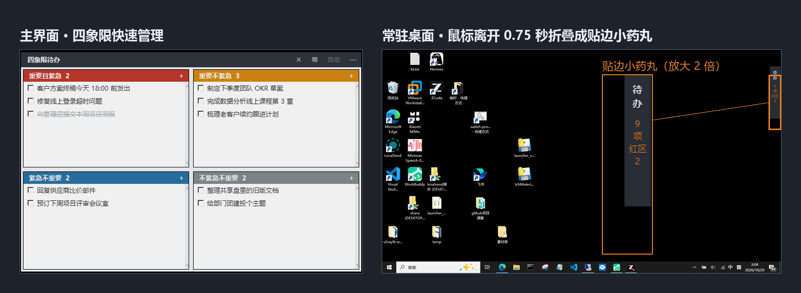
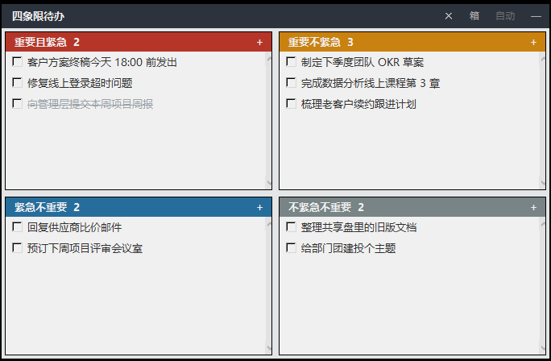

# QuadTodo

> 桌面四象限（艾森豪威尔矩阵）待办小窗 — 置顶、可折叠贴边、纯本地、零依赖。
> A pinned, collapsible Eisenhower-matrix to-do widget for Windows. Pure tkinter, zero dependencies.

  

  

当前版本：**v0.4** ・ License：[MIT](LICENSE)

**最快上手（推荐）**：点击本仓库页面上方的 **Releases / 发行版** 入口，下载最新的 `QuadTodo-v*-win64-portable.zip`，解压后双击 `QuadTodo.bat` —— 内置运行时，无需安装 Python。

- Gitee 发行版（国内推荐）：<https://gitee.com/geekkkk404/quad-todo/releases>
- GitHub Releases：<https://github.com/geekkkk404/quad-todo/releases/latest>

> ⚠️ 请认准发行版里的绿色包 zip。仓库代码页的「下载 zip / tar.gz」按钮是**源码包**，不含运行时，无法双击直接使用。

**源码方式**：下载 `quad_todo.pyw` 双击运行，需已安装 Python 3.8+（仅标准库 tkinter，无需 pip 安装任何东西）。

> 国内镜像：[gitee.com/geekkkk404/quad-todo](https://gitee.com/geekkkk404/quad-todo)（Actions 自动同步，发行版同步发布）。Issue 请统一到 GitHub 提交。

## 特性

- **四象限管理**：重要/紧急二维分类，红/橙/蓝/灰四色分区，右键拖移象限
- **桌面常驻**：置顶无边框小窗；鼠标离开约 0.75 秒自动折叠成贴边药丸（显示待办数与红区数），移上去展开；指针静止时不弹跳，拖动中不折叠
- **完整任务操作**：快速添加、勾选完成、双击编辑、右键菜单（编辑/移动/归档/删除）
- **归档箱**：收纳完成的任务，支持恢复到原象限、彻底删除、一键清空
- **纯本地**：数据存单个 JSON 文件，放进 OneDrive/坚果云等同步盘即可多机同步
- **极轻量**：空闲内存约 28 MB，零第三方依赖

## 环境要求

- Windows 10 / 11
- 绿色免安装包：无任何外部依赖，开箱即用
- 源码运行：Python 3.8+

## 使用

- 双击 `quad_todo.pyw` 启动（无控制台窗口）。
- 各象限右上角 **＋** 快速添加任务，回车确认。
- **左键勾选**完成（划线保留）；**双击**编辑；**右键** → 编辑 / 移动到其他象限 / 归档 / 删除。
- **归档**：右键任务 → 归档，任务收进归档箱不再显示；标题栏 **箱** 打开归档箱，每条 ↩ 恢复到原象限、✕ 彻底删除，右上角"清空全部"带确认弹窗。
- 标题栏 **—** 立即折叠；**自动**（绿=开）控制悬停自动展开/离开自动折叠；拖住标题栏移动位置；**✕** 退出。
- 滚轮在列表内滚动查看更多任务。

## 数据与备份

所有任务保存在脚本同目录的 `tasks.json`（含窗口位置与设置），纯文本，可直接备份。

## 开机自启

双击 `开机自启-安装或取消.bat` 切换：往启动文件夹写入/删除 `QuadTodo.lnk`（指向系统 `pyw.exe`，不依赖 .pyw 文件关联）。bat 壳保持纯 ASCII，逻辑在 `autostart.ps1`（UTF-8 BOM），避开 cmd 的编码坑。

## 自定义

- 窗口默认尺寸：`quad_todo.pyw` 顶部 `W, H`
- 象限名称/颜色/提示语：`QUADS` 列表
- 自检模式：`python quad_todo.pyw --smoke`

## 发布新版本（维护者）

一键发版：把本次更新内容写进仓库根目录的 `RELEASE_NOTES.md`（markdown 列表），然后双击 `scripts\发版-一键发布.bat`。脚本自动完成：

1. 预检（main 分支、与远端同步、工作区干净）；
2. 输入版本号（回车取默认 = 当前小版本 +1，自动回写 `APP_VERSION` 与 README 版本号并提交）→ 打 tag 推送；
3. 等待 CI 构建发布（GitHub Release + Gitee 发行版说明），失败会给出排查链接与清理命令；
4. 从 GitHub Release 下载绿色包到 `dist\`，复用 `scripts\upload-gitee-release.ps1` 从本地网络补传 Gitee 附件（令牌读 `.gitee-token`）。

手动兜底（脚本中断时）：tag 已推送则等 CI 完成后手动下载 zip 放进 `dist\`，再跑 `python scripts/gitee_release.py vX.Y dist/<zip> dist/RELEASE.md`（或双击 `scripts\发行版-上传附件到Gitee.bat`）。实测 GitHub 机房到 Gitee 的大文件传输不可用，附件必须走国内网络。

## License

[MIT](LICENSE)
